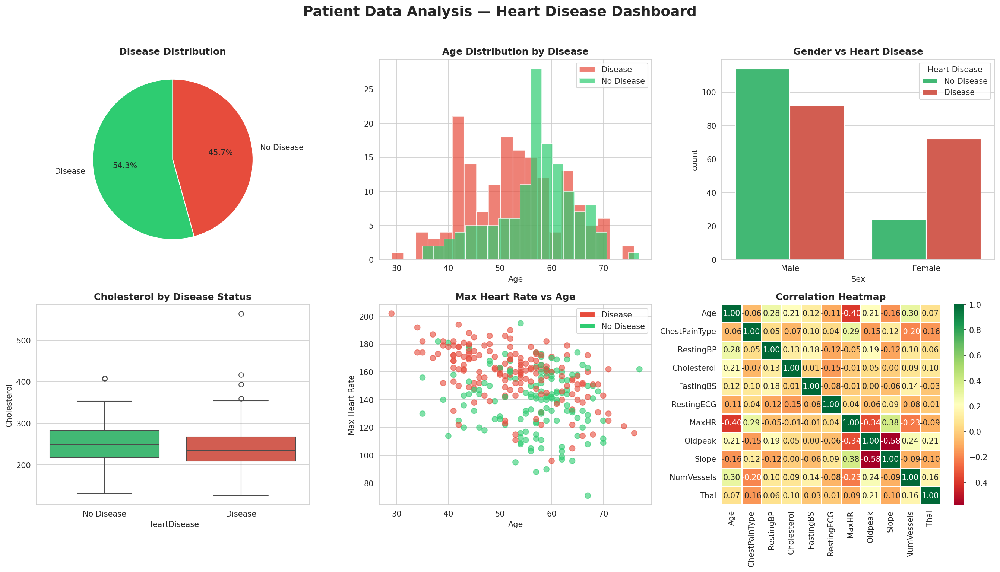

# Patient Data Analysis: Heart Disease Dataset

Exploratory analysis of the Kaggle version of the UCI heart disease dataset with Python, SQL (SQLite) and a six-panel dashboard. The most important result turned out to be about **data quality**: the file contains many duplicate rows, and its disease labels appear to be reversed.

📝 **Blog post:** [When My Data Disagreed With the Textbook](https://mdabrarfaiyaj.github.io/posts/When-My-Data-Disagreed-With-the-Textbook/)

---

## Tools

Python (pandas, NumPy, Matplotlib, Seaborn) · SQL (SQLite via `sqlite3`) · Jupyter Notebook · Git/GitHub

## Project structure

```
patient-data-analysis/
├── data/        heart.csv (Kaggle) and the SQLite database
├── notebooks/   patient_analysis.ipynb (full analysis)
├── outputs/     dashboard.png
├── sql/         queries.sql
└── README.md
```

---

## Dataset

- **Source:** [Heart Disease Dataset on Kaggle](https://www.kaggle.com/datasets/johnsmith88/heart-disease-dataset), derived from the UCI heart disease data (Cleveland study; Detrano et al., 1989).
- **Rows:** 1,025, but only **302 are unique**. Each patient appears about three times. The notebook removes duplicates before any analysis, so **all results below use 302 patients**.
- **Variables:** 14, including age, sex, chest-pain type, resting blood pressure, cholesterol, maximum heart rate (`thalach`), ST depression (`oldpeak`), number of major vessels (`ca`) and a 0/1 `target`.

---

## Questions

1. What share of patients is labelled as having heart disease?
2. How do age, sex, cholesterol and maximum heart rate differ between the groups?
3. Which variables are correlated?

## Dashboard



The dashboard uses the labels exactly as provided in the Kaggle file (`target = 1` shown as "Disease"). Please read the section on label direction below before interpreting it.

---

## Key findings

### Group differences (302 unique patients, labels as provided)

| | `target = 1` ("Disease") | `target = 0` ("No disease") |
|---|---|---|
| Patients | 164 (54.3%) | 138 (45.7%) |
| Mean age | 52.6 years | 56.6 years |
| Mean maximum heart rate | 158 bpm | 139 bpm |
| Mean ST depression | 0.6 | 1.6 |
| Mean number of major vessels | 0.3 | 1.2 |
| Women in group | 72 | 24 |

### The labels appear to be reversed

Taken at face value, the "Disease" group is younger, reaches higher heart rates, has less ST depression, fewer affected vessels, and contains most of the women. Every one of these points runs **opposite** to established cardiology and to the original Cleveland study.

The original Cleveland data has **164 patients without disease and 139 with disease**. In this file, the group labelled `target = 1` has exactly **164** patients. The share of women in the `target = 0` group (24 of 96, 25%) also matches the share of women *with* disease in the original study.

The most likely explanation is that **0 and 1 were swapped** when this version of the dataset was created, which many Kaggle users have also reported. With the labels flipped, the results agree with medicine: patients with disease are older, reach lower maximum heart rates, show more ST depression and more affected vessels, and are more often men.

> An earlier version of this README interpreted the results using textbook expectations without noticing that the numbers showed the opposite. That has been corrected here.

### Findings that do not depend on label direction

- **Cholesterol separates the groups poorly.** Median cholesterol is similar in both groups and the distributions overlap heavily; 126 of 302 patients have cholesterol above 250 mg/dL.
- **Correlations** (302 unique patients):
  - Maximum heart rate vs. age: **−0.40** (heart rate capacity falls with age)
  - Maximum heart rate vs. ST depression: **−0.34**
  - ST depression vs. ST slope: **−0.58**
  - Age vs. number of major vessels: **0.30**
  - Cholesterol: weak correlation with all other variables (|r| ≤ 0.21)

---

## Limitations

- 302 unique patients from a hospital study in the 1980s; all were already being tested for heart disease, so this is not a general-population sample.
- The label reversal is strongly supported by the evidence above but cannot be proven from this file alone. The original UCI data should be used for any real modelling.
- This is an educational exploratory analysis, not a clinical study.

---

## How to run

```bash
git clone https://github.com/mdabrarfaiyaj/patient-data-analysis
cd patient-data-analysis
pip install -r requirements.txt
jupyter notebook
```

Open `notebooks/patient_analysis.ipynb` and run all cells from top to bottom.

---

## References

1. Detrano R, Janosi A, Steinbrunn W, et al. (1989). International application of a new probability algorithm for the diagnosis of coronary artery disease. *American Journal of Cardiology* 64(5): 304–310.
2. Janosi A, Steinbrunn W, Pfisterer M, Detrano R (1988). Heart Disease [Dataset]. UCI Machine Learning Repository.

---

**Author:** Md. Abrar Faiyaj, M.Sc. Biotechnology, BRAC University · [Website](https://mdabrarfaiyaj.github.io/) · [GitHub](https://github.com/mdabrarfaiyaj) · [LinkedIn](https://www.linkedin.com/in/md-abrar-faiyaj-559246381)
